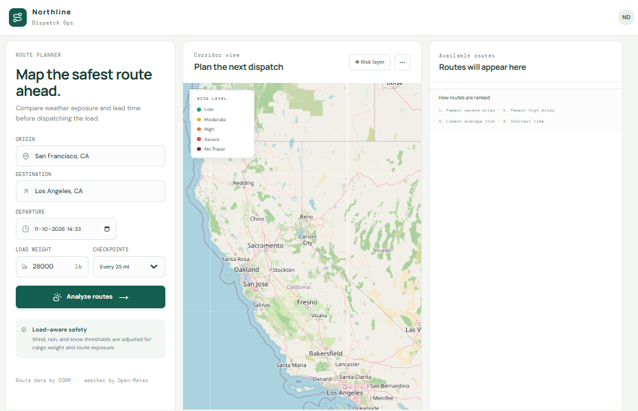
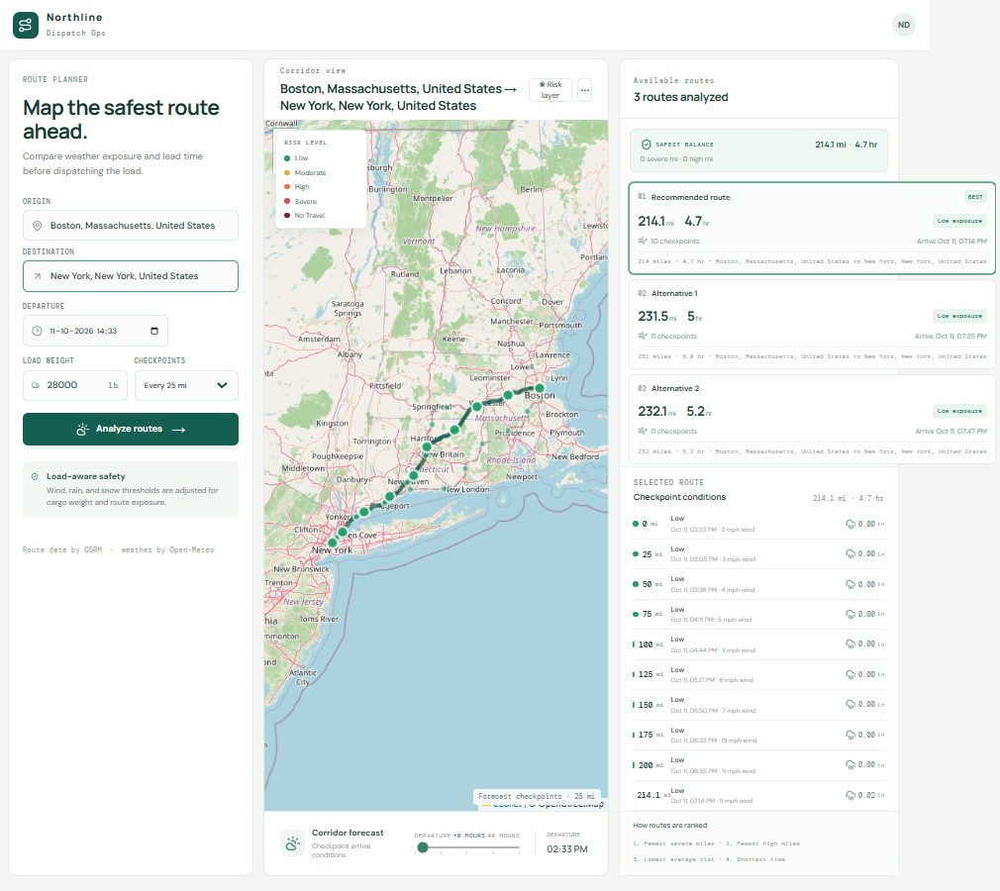
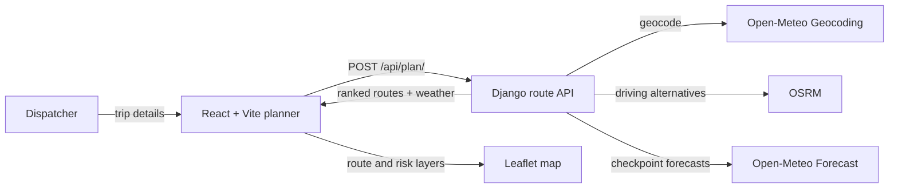

<div align="center">

# Northline Dispatch Ops

### Weather-aware route planning for safer freight dispatch.

Compare driving routes using forecast weather, truck load, and travel time. Review checkpoint conditions along the corridor and prioritize routes with lower exposure to severe weather.

<p>
  <a href="https://northline-frontend.onrender.com/"><strong>Launch the live application</strong></a>
  &nbsp;·&nbsp;
  <a href="https://github.com/RONIN447/northline_dispatch_ops">Source code</a>
</p>

<p>
  <a href="https://github.com/RONIN447/northline_dispatch_ops/actions/workflows/ci.yml"></a>
  <a href="https://northline-frontend.onrender.com/"></a>
  
  
  <a href="./LICENSE"></a>
</p>

</div>

<!-- <p align="center">
  
</p> -->

<!-- <details>
  <summary><strong>View a route recommendation and checkpoint forecast</strong></summary>
  <br>
  
</details> -->

## What it does

Dispatchers enter an origin, destination, departure time, cargo weight, and checkpoint interval. Northline resolves the locations, requests available driving routes, samples forecast conditions along each route, and presents a safety-first comparison.

### Highlights

- **Three route options:** requests three routes from OSRM and, when its natural alternatives are limited, asks the routing API for additional distinct routes through offset waypoints.
- **Weather-aware checkpoints:** samples wind, rain, and snow at configurable 10, 25, or 50 mile intervals.
- **Arrival-time forecasts:** estimates when the truck reaches each checkpoint and uses the nearest available hourly forecast.
- **Load-aware risk:** applies cargo-weight adjustments to the weather risk assessment.
- **Explainable recommendations:** ranks route options using severe exposure first, followed by high-risk miles, distance-weighted average risk, and duration.
- **Interactive map:** displays route geometry, checkpoint conditions, risk overlays, and a 0-48 hour departure forecast.
- **Fail-closed forecast handling:** reports unavailable forecast data instead of presenting missing weather as safe.

### Risk assessment

| Condition | Low | Moderate | High | Severe | No Travel |
| --- | --- | --- | --- | --- | --- |
| Wind (mph) | <25 | 25-<35 | 35-<45 | 45-<55 | >=55 |
| Rain (in/hr) | <0.10 | 0.10-<0.25 | 0.25-<0.50 | 0.50-1.00 | >1.00 |
| Snow (in/hr) | <0.5 | 0.5-<1.0 | 1.0-<2.0 | 2.0-3.0 | >3.0 |

Additional load rules: wind from 45 to under 55 mph becomes **No Travel** above 30,000 lb; wind from 35 to under 45 mph is at least **Severe** above 40,000 lb. Wind at or above 55 mph is **No Travel** for every load.

## Architecture



| Layer | Implementation |
| --- | --- |
| Frontend | React 18, Vite, Leaflet, React Leaflet, Lucide |
| Backend | Python, Django, Requests |
| Route provider | OSRM public routing service |
| Geocoding and weather | Open-Meteo APIs |
| Hosting | Render static site and web service |

## Run locally

### Prerequisites

- Python 3.9 or newer
- Node.js 18 or newer
- npm

### 1. Start the backend

In PowerShell from the repository root:

```powershell
cd backend
python -m venv .venv
.\.venv\Scripts\Activate.ps1
pip install -r requirements.txt
$env:DJANGO_SETTINGS_MODULE = "settings"
$env:DEBUG = "True"
python -m django runserver 8000
```

The API is available at `http://127.0.0.1:8000`. The backend health endpoint is `http://127.0.0.1:8000/api/health/`.
### 2. Start the frontend

In a second PowerShell window from the repository root:

```powershell
cd frontend
npm ci
$env:VITE_API_BASE_URL = "http://127.0.0.1:8000"
npm run dev
```

Open the Vite URL shown in the terminal, normally `http://localhost:5173`.

Environment variable examples are documented in [`.env.example`](./.env.example). Do not commit production secrets or a populated `.env` file.

## API

| Method | Endpoint | Purpose |
| --- | --- | --- |
| `GET` | `/api/health/` | Render health check; returns `{"status":"ok"}` |
| `POST` | `/api/plan/` | Geocode locations, score available routes, and return the recommendation |

Example request:

```json
{
  "origin": "San Francisco, CA",
  "destination": "Los Angeles, CA",
  "departure": "2026-10-10T12:00:00Z",
  "loadWeight": "28000",
  "intervalMiles": "25"
}
```

The plan response includes the resolved endpoints, available route geometries, checkpoint ETAs and forecast conditions, risk summaries, and `recommendedRouteId`. Invalid input returns a client error with an explanatory message; unavailable forecast data is not silently classified as safe.

## Tests and build

Run the backend regression tests:

```powershell
cd backend
python -m unittest routing.test_risk_rules
```

Build the frontend for production:

```powershell
cd frontend
npm ci
npm run build
```

GitHub Actions runs the backend tests on Python 3.9 and 3.14 and verifies a production frontend build on pushes and pull requests.

## Deployment

The live application is hosted on Render:

- **Frontend:** [northline-frontend.onrender.com](https://northline-frontend.onrender.com/)
- **Backend health:** [northline-backend-wvdw.onrender.com/api/health/](https://northline-backend-wvdw.onrender.com/api/health/)

The root [`render.yaml`](./render.yaml) defines both services. Create or update the Render Blueprint from this repository to provision the static frontend and Django backend. Keep `SECRET_KEY` in Render's environment settings, set `DEBUG=False`, and use the deployed frontend origin for the backend's `FRONTEND_URL` and `CORS_ALLOWED_ORIGINS`.

The frontend reads `VITE_API_BASE_URL` at build time; redeploy it after changing that value. See the [deployment guide](./docs/DEPLOYMENT.md) for configuration details. The free backend instance may spin down while idle, so its first request after inactivity can take longer.

## Limitations and safety

- OSRM and Open-Meteo public services are demonstration providers and may be subject to availability or rate limits.
- Weather is sampled from hourly forecast data; conditions can change between forecast hours and checkpoints.
- OSRM may not be able to find three distinct drivable routes for every pair of locations. In that case, planning fails with an explanation instead of showing fewer than three options or presenting duplicate paths as alternatives.
- This application provides decision support, not a guarantee of road safety. Follow current carrier policy, official road advisories, and applicable regulations before dispatch.

## Repository layout

```text
backend/
  routing/
    test_risk_rules.py   # Risk thresholds, forecast handling, API regressions
    views.py             # Geocoding, routing, weather sampling, scoring
  settings.py
  urls.py
  wsgi.py
docs/
  images/                # Live application screenshots
  DEPLOYMENT.md
  LOOM_SCRIPT.md
frontend/
  src/main.jsx           # Route planner, map, forecast, recommendations
  src/style.css
render.yaml              # Render Blueprint for frontend and backend
```

## License

Distributed under the MIT License. See [`LICENSE`](./LICENSE).
